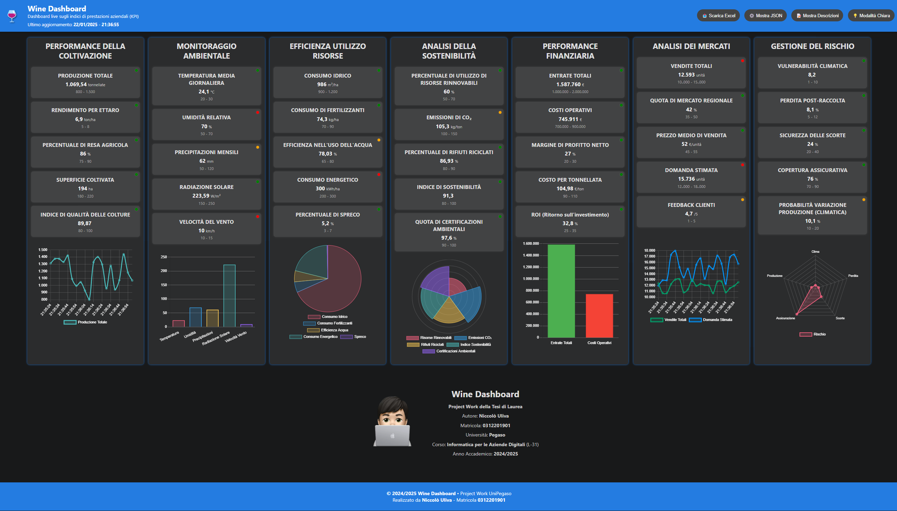

# 🍷 Wine Dashboard

**Wine Dashboard** è una dashboard dimostrativa per visualizzare KPI del settore vinicolo a partire da dati simulati. Il progetto nasce come Project Work universitario dell'anno accademico 2024/2025.

Repository: [niccolouliva/WineDashboard](https://github.com/niccolouliva/WineDashboard).



## Stato del progetto e architettura

Il progetto distingue tre responsabilità:

| Componente | Ruolo | Disponibilità nel repository |
| --- | --- | --- |
| Dashboard React | Visualizza KPI, grafici, descrizioni e JSON; richiede il download Excel | Presente in `src/` |
| Backend FastAPI | Espone le API consumate dal frontend e genera il file Excel | Descritto nella documentazione originaria, ma sorgenti Python assenti su `main` al momento di questa revisione |
| Simulatore Python | Genera i dati dimostrativi, secondo la documentazione originaria tramite NumPy e distribuzioni gaussiane | Il file `simulator.py` non è incluso |

**La sola clonazione consente di installare e avviare il frontend, ma non di eseguire l'intero sistema con dati ed esportazione Excel.** Occorre recuperare separatamente il backend originale. Installare FastAPI non ricrea il simulatore mancante.

I dati descritti e mostrati nelle anteprime sono simulati: non rappresentano misurazioni di un'azienda reale. Il progetto è una dimostrazione accademica; questo README non attesta una versione pronta per l'uso in produzione.

## Funzionalità principali

- Visualizzazione di KPI relativi a coltivazione, ambiente, risorse, sostenibilità, finanza, mercati e rischio.
- Grafici interattivi con Chart.js: radar, barre, linee, polar area e torta.
- Aggiornamento dei dati tramite richieste HTTP periodiche: `src/components/Simulator.js` interroga `/real-time-data` ogni **5 secondi**.
- Download Excel tramite il backend.
- Visualizzazione e copia dei dati JSON, descrizioni dei KPI e modalità chiara/scura.
- Interfaccia con stili per desktop e dispositivi mobili.

L'aggiornamento implementato nel frontend è **polling**, non una connessione di streaming continua. Dati ed esportazione richiedono un backend compatibile in esecuzione.

## Obiettivi

Il Project Work esplora la digitalizzazione delle imprese vinicole, il monitoraggio della sostenibilità ambientale e l'uso di KPI a supporto delle decisioni. L'adattamento a dati reali o ad altri settori richiede integrazioni e verifiche ulteriori.

## Struttura del progetto

| Percorso | Contenuto |
| --- | --- |
| `package.json`, `package-lock.json` | Dipendenze e comandi del frontend |
| `public/` | Pagina HTML e risorse pubbliche |
| `src/App.js`, `src/App.css` | Interfaccia principale e stili |
| `src/components/Simulator.js` | Hook React che recupera i dati dall'API; non è il simulatore Python |
| `src/components/cards/` | Sette sezioni KPI |
| `src/components/KpiCard.js`, `src/components/KpiCard.css` | Componente e stili delle schede KPI |
| `src/components/example/` | Immagini di anteprima |
| `src/components/images/` | Immagini dell'interfaccia |
| `[START] Dashboard.BAT` | Script Windows per avviare il frontend |

Le sette sezioni effettivamente montate in `src/App.js` sono:

1. Performance della coltivazione.
2. Monitoraggio ambientale.
3. Efficienza nell'utilizzo delle risorse.
4. Analisi della sostenibilità.
5. Performance finanziaria.
6. Analisi dei mercati.
7. Gestione del rischio.

## Tecnologie utilizzate

**Frontend:** React 18, React Scripts 5, Chart.js e react-chartjs-2, JavaScript, CSS, HTML e JSON. Le dipendenze complete sono in `package.json`.

**Backend descritto nel Project Work:** Python, FastAPI, Uvicorn, NumPy, OpenPyXL e ThreadPoolExecutor. Versioni, dipendenze complete e implementazione non sono verificabili senza i sorgenti Python; non è presente un file dei requisiti Python.

## Installazione e avvio su Windows

### 1. Verifica i prerequisiti

Installa Git e Node.js con npm. Python con pip serve soltanto per il backend, una volta recuperato.

Apri il **Prompt dei comandi (cmd)** ed esegui:

```bat
git --version
node --version
npm --version
```

Per la parte Python:

```bat
py --version
```

Il repository non dichiara una versione Node.js o Python collaudata: i comandi seguenti documentano il flusso di avvio, non una verifica di compatibilità con tutte le versioni disponibili.

### 2. Clona il repository

```bat
git clone https://github.com/niccolouliva/WineDashboard.git
cd WineDashboard
```

Esegui i comandi npm dalla cartella che contiene `package.json`.

### 3. Installa le dipendenze del frontend

```bat
npm ci
```

Il repository contiene `package-lock.json`: `npm ci` installa le dipendenze fissate dal lockfile. Se segnala un disallineamento con `package.json`, verifica di avere una copia coerente del progetto. `npm install` è l'alternativa quando si intende aggiornare il lockfile; controllane poi le modifiche.

### 4. Avvia la dashboard React — terminale A

```bat
npm start
```

Apri [http://localhost:3000](http://localhost:3000) e lascia il terminale aperto. Se la porta 3000 è occupata, libera la porta prima di procedere, oppure adegua anche la configurazione CORS del backend alla porta alternativa.

Il frontend può partire senza backend, ma le richieste dati e il download Excel non funzioneranno.

### 5. Prepara il backend/simulatore — terminale B

**Esegui questo passaggio soltanto dopo aver recuperato il backend originale.** Nel repository attuale non esiste `simulator.py`; il comando Uvicorn del passaggio successivo altrimenti termina con un errore di importazione.

Apri un secondo Prompt dei comandi nella cartella che contiene il file recuperato `simulator.py`. Crea un ambiente virtuale:

```bat
py -m venv .venv
.venv\Scripts\python.exe -m pip install fastapi uvicorn numpy openpyxl
```

Queste sono le dipendenze indicate nel README originale. Se il backend recuperato include un proprio file dei requisiti, usa quello; potrebbero essere necessarie altre dipendenze o versioni specifiche.

L'uso diretto dell'interprete dell'ambiente virtuale evita di dover attivare l'ambiente o modificare le policy di PowerShell.

### 6. Avvia il backend/simulatore — terminale B

Se `simulator.py` espone un'applicazione FastAPI chiamata `app`, esegui dalla sua cartella:

```bat
.venv\Scripts\python.exe -m uvicorn simulator:app --host 127.0.0.1 --port 8000 --reload
```

`simulator:app` indica il modulo Python `simulator.py` e l'oggetto `app`. Adatta il comando soltanto se i sorgenti recuperati usano nomi diversi. `--reload` serve allo sviluppo locale.

Il frontend usa attualmente due indirizzi:
- Dati: `http://127.0.0.1:8000/real-time-data`, in `src/components/Simulator.js`.
- Excel: `http://localhost:8000/download-excel`, in `src/App.js`.

Il backend deve consentire via CORS l'origine del frontend, normalmente `http://localhost:3000`. Se cambi host o porta, aggiorna anche gli URL nel frontend e la configurazione CORS del backend.

### 7. Verifica e arresta i servizi

Con entrambi i terminali aperti:

- Visita [http://127.0.0.1:8000/real-time-data](http://127.0.0.1:8000/real-time-data) e verifica che restituisca JSON compatibile con le schede.
- Apri la dashboard e verifica aggiornamento dei KPI e download Excel.
- Se disponibili nel backend recuperato, consulta le API su [http://127.0.0.1:8000/docs](http://127.0.0.1:8000/docs).
- Premi **Ctrl+C** in ciascun terminale per arrestare il relativo servizio.

Per gli avvii successivi basta ripetere i passaggi 4 e 6, purché dipendenze e backend siano già disponibili.

### Nota su PowerShell e sugli script BAT

In PowerShell puoi usare gli stessi comandi Git; se `npm.ps1` è bloccato, usa `npm.cmd ci` e `npm.cmd start`. Per Python il percorso del comando è `./.venv/Scripts/python.exe` seguito dagli stessi argomenti riportati sopra.

Il file `[START] Dashboard.BAT` è una scorciatoia per il solo frontend e richiede dipendenze già installate. La sintassi `%~dp0` appartiene ai file batch e non va copiata come comando autonomo in un terminale. Per diagnosticare gli errori usa l'avvio manuale descritto sopra.

## Endpoint principali

| Endpoint | Utilizzo | Stato verificabile |
| --- | --- | --- |
| `GET /real-time-data` | KPI simulati in JSON | Chiamato dal frontend ogni 5 secondi |
| `GET /download-excel` | Download dei dati in Excel | Chiamato dal pulsante di esportazione |
| `/stream-data` | Flusso continuo descritto nel README originale | Non usato dal hook React attuale; implementazione da verificare nel backend recuperato |

La presenza di una chiamata nel frontend non garantisce che il relativo endpoint sia disponibile: serve il backend.

## Grafici disponibili

- **Radar:** gestione del rischio.
- **Barre:** ambiente e mercati.
- **Linee:** andamenti temporali.
- **Polar area:** sostenibilità.
- **Torta:** distribuzione delle risorse.

## Risoluzione dei problemi

| Problema | Verifica |
| --- | --- |
| `npm`, `git` o `py` non riconosciuti | Verifica l'installazione e riapri il terminale; se il launcher `py` manca, prova `python --version` e usa `python -m venv .venv` |
| `package.json` non trovato | Esegui npm dalla cartella `WineDashboard` |
| `Could not import module "simulator"` | Recupera `simulator.py` e avvia Uvicorn dalla sua cartella |
| Dati assenti o errore di rete | Controlla backend, porta 8000, URL e console del browser |
| Errore CORS | Configura nel backend l'origine esatta del frontend |
| Excel non scaricabile | Controlla `/download-excel` e il log del backend |

## Strumenti di sviluppo

Il Project Work è stato realizzato con Visual Studio Code e gli strumenti di sviluppo di Google Chrome.

Comandi frontend aggiuntivi, definiti in `package.json`:

```bat
npm run build
npm test
```

La build produce i file statici del frontend; non include né avvia il backend Python.

## Contributi

1. Crea un fork di [niccolouliva/WineDashboard](https://github.com/niccolouliva/WineDashboard).
2. Crea un branch: `git checkout -b feature/nome-feature`.
3. Apporta le modifiche e verifica le funzionalità interessate.
4. Apri una pull request descrivendo modifiche e verifiche eseguite.

## Autore e contesto accademico

Queste informazioni descrivono l'origine del lavoro e sono separate dalle istruzioni tecniche.

- **Autore:** Niccolò Uliva.
- **Università:** Università Telematica Pegaso.
- **Corso:** Informatica per le Aziende Digitali (L-31).
- **Anno accademico:** 2024/2025.
- **Contesto:** Project Work della tesi di laurea triennale.

## 🖼️ Anteprima del Progetto

<div align="center">
  
  <br><br>
  
  <br><br>
  
  <br><br>
  
  <br><br>
  
  <br><br>
  
  <br><br>
  
  <br><br>
  
  <br><br>
  
  <br><br>
  
  <br><br>
  
  <br><br>
  
  <br><br>
  
  <br><br>
  
  <br><br>
  
  <br><br>
  
  <br><br>
  
  <br><br>
  
  <br><br>
  
  <br><br>
  
  <br><br>
</div>

